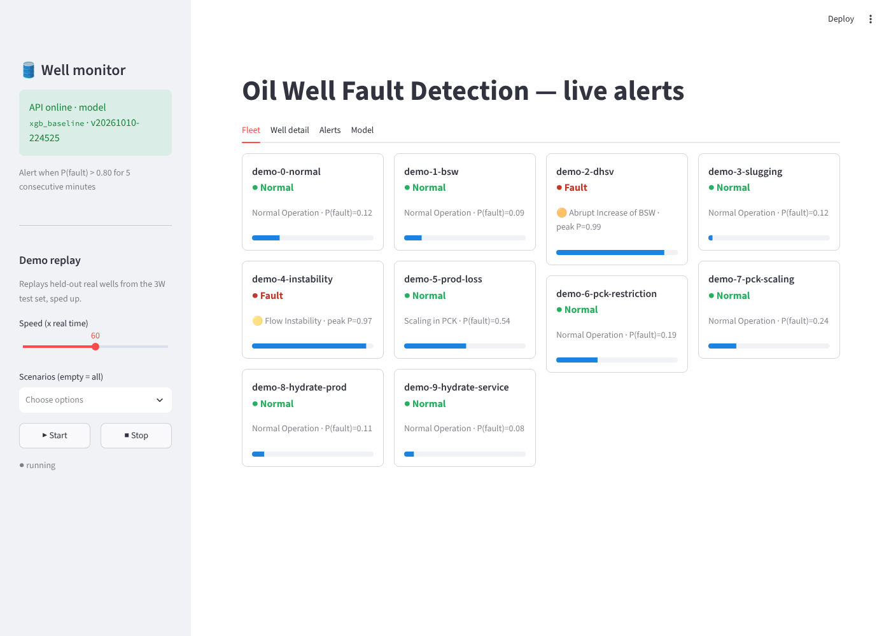
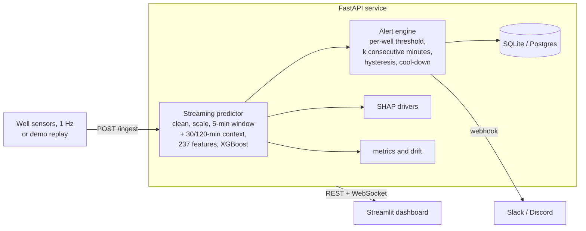

# Oil Well Fault Detection System

[](https://github.com/nomad-gokul/Oil-Well-Fault-Detection-/actions/workflows/ci.yml)

An ML early-warning system that detects operational faults in **offshore oil wells** from real
1 Hz sensor time series (the [Petrobras 3W dataset](https://github.com/petrobras/3W)), served by
a **FastAPI** service with streaming ingestion, an alert engine and SHAP explanations, and a
live **Streamlit** alert dashboard.

**Live demo:** [dashboard](https://oilwellfaultdetection.streamlit.app/) ·
[API docs](https://owfd-api-production.up.railway.app/docs) (10 held-out real wells replayed at 30x
speed; the first load may take a minute while the services wake up)



## Results on wells the model never saw

No well appears in both training and evaluation. The production model and alert rule were
chosen without the test wells; test numbers are reported once.

| | Test wells (10 wells, 126 fault episodes) | All 40 wells, cross-validation (482 episodes) |
|---|---:|---:|
| Fault vs normal per 5-min window: ROC-AUC / PR-AUC | **0.85 / 0.90** | |
| 10-class macro F1 per window | 0.46 | |
| Fault episodes detected by the alert rule | **52%** at 1.8 false alarms / day | 31% at 1 / day, 43% at 3 / day (pooled) |
| ... excluding flow instability | 37% (31 of 62 are slugging on one well) | 55% |
| Always caught (test) | DHSV closure, PCK scaling, production-line hydrate | DHSV closure: 100% |
| Median delay after fault onset | 4 min | 7 min |
| Median warning before the fault reaches steady state | 307 min | 173 min |
| `/predict` latency (one 5-min window, CPU, incl. SHAP) | 28 ms median | |

The two columns differ a lot, and that is the main lesson of the evaluation: the 10 test
wells are easier than average. Across all 40 wells (5-fold cross-validation by well with 95%
bootstrap intervals), detection is dominated by **flow instability on two chronically unstable
wells** (201 of 482 episodes, almost never detected: those wells are unstable from the first
minute of every recording, so there is no "normal" to deviate from). Sudden, well-defined events
are caught reliably. Details: [docs/cross_validation.md](docs/cross_validation.md),
[docs/early_warning.md](docs/early_warning.md), [docs/model_card.md](docs/model_card.md).

## How it works



1. **Data** — 2,228 instances (1,119 real from 40 wells, 1,089 simulated, 20 hand-drawn),
   10 event classes ([data report](docs/data_report.md)). 7 core sensors; stuck sensors and gaps
   become explicit missing-value masks.
2. **Leak-free evaluation** — real instances split **by well**; validation and test use real
   data only; synthetic data is for training only. On top, **5-fold cross-validation by well**
   over all 40 real wells with nested tuning and bootstrap intervals, because 7–10 wells per
   split turned out to be too few to trust a single split.
3. **Features** — 5-minute windows every minute; per-sensor statistics plus **deviations from
   each well's own baseline** (first hour of the stream). In a controlled comparison this one
   idea lifted validation macro F1 from 0.20 to 0.35: wells run at very different pressures,
   so "how far from this well's normal" generalises across wells, absolute levels do not.
   Plus **long-context features**: one-minute averages over the last 30 and 120 minutes
   (level, spread, trend, oscillation period and strength), for cyclic faults longer than a
   5-minute window. Across 40 wells they add 6–8 points of detection at equal false-alarm
   rates.
4. **Models** — XGBoost (tuned with Optuna) vs a PyTorch CNN/GRU. The deep model memorised
   training wells (validation F1 0.08) and is kept as a documented negative result.
5. **Early warning** — alerts when P(fault) > 0.85 for 5 consecutive minutes, with each
   well's threshold raised after a one-hour burn-in if the model already reads high while the
   well runs normally; rule chosen on the 30 non-test wells within a false-alarm budget;
   probabilities calibrated by temperature scaling.
6. **Serving** — the same preprocessing code online and offline (verified identical to 1e-7 on
   real recordings), PyTorch-free ~560 MB image, alert lifecycle, SHAP drivers on every alert,
   Prometheus metrics and a fleet-level drift check.

## Run it locally

```bash
git clone https://github.com/nomad-gokul/Oil-Well-Fault-Detection-.git && cd Oil-Well-Fault-Detection-
OWFD_API_KEY=change-me docker compose up -d --build --wait   # API :8000 (demo mode) + dashboard :8501
# then open http://localhost:8501
```

Without Docker (Python 3.11): `make install-all`, then `make serve` and `make dashboard` in two
terminals. The production model is committed in `deploy/bundle/`, so no training is needed.

## Reproduce the training pipeline

```bash
make install-all
python -m owfd.data.download            # sparse clone of petrobras/3W (~1.8 GB) + instance index
python -m owfd.data.profile             # per-instance data-quality profile (EDA input)
python -m owfd.data.preprocess          # cleaned instances
python -m owfd.data.split               # well-level split -> configs/splits.json (committed)
python -m owfd.data.windows             # scaler fit on train only; 5-min windows
python -m owfd.features.build           # 237 features per window (+ burn-in, CV tables)
python -m owfd.models.train_xgb --config configs/xgb_tuned.yaml --name xgb_ctx
python -m owfd.models.train_dl --arch cnn            # optional comparison (CPU: ~30 min)
python -m owfd.models.tune --model xgb --trials 15   # optional
python -m owfd.models.cv --model artifacts/xgb/xgb_ctx-<version>   # CV by well (~30 min)
python -m owfd.models.evaluate --select-on cv --models artifacts/xgb/xgb_ctx-<version>
                                        # early-warning evaluation, writes configs/serving.yaml
python -m owfd.models.explain --model artifacts/xgb/xgb_ctx-<version>   # SHAP per class
python -m owfd.models.export            # serving bundle -> artifacts/serving/<version>
make publish-bundle                     # -> deploy/bundle (used by the Docker image)
```

Experiments are tracked in MLflow (`mlflow ui --backend-store-uri sqlite:///mlflow.db`).

## API

| Endpoint | |
|---|---|
| `POST /predict` | score a 5-minute window (300 readings): class probabilities, P(fault), top SHAP drivers |
| `POST /ingest` 🔑 | stream readings for a well: predictions every minute + alert changes |
| `GET /alerts`, `POST /alerts/{id}/ack` 🔑 | alert history with filters; acknowledge |
| `GET /wells/{id}/predictions`, `/wells/{id}/readings` | recent history for charts |
| `WS /ws/{well_id}` (or `all`) | live predictions and alerts |
| `GET /monitoring/drift`, `GET /metrics` | fleet drift check, Prometheus metrics |
| `GET /health`, `/model`, `/demo`; `POST /demo/start`, `/demo/stop` 🔑 | status, model info, demo replay |

🔑 = requires `X-API-Key`. Interactive docs at `/docs`.

## Project structure

```
src/owfd/
  data/        download, load, profile, clean, split, windows (incl. stream baseline)
  features/    125 vectorised window features
  features/    5-minute window statistics + 30/120-minute context features
  models/      train_xgb, train_dl, nets, tune, evaluate, cv, explain, export, metrics
  inference/   predictor (streaming, PyTorch-free), alerting
  api/         FastAPI app, schemas, persistence
  dashboard/   Streamlit app + API client
  simulator/   replay of 3W instances as live wells; demo-set builder
  monitoring/  fleet drift check
configs/       YAML settings, split manifest, serving choice
deploy/bundle/ production model bundle (< 1 MB)
demo_data/     10 held-out test scenarios for the live demo (2 MB)
docs/          data report, results, early warning, monitoring, performance, deployment, model card
tests/         151 tests (unit, integration, API, dashboard) + a Locust load test
```

## Tech stack

Python 3.11 · pandas · NumPy · XGBoost · PyTorch · Optuna · SHAP · MLflow · scikit-learn ·
FastAPI · Pydantic v2 · SQLAlchemy · ONNX Runtime · Prometheus client · Streamlit · Plotly ·
Docker · GitHub Actions · Railway / Render · Streamlit Community Cloud

## Limitations and future work

- **Generalisation across wells is the hard part.** Across all 40 wells about one in four fault
  episodes is caught at about one false alarm per day; the 10 test wells (52%) are easier than
  average. Rare classes have 1–3 real test instances; per-class scores for them are noisy.
- **Chronic flow instability** (71% of all fault episodes, mostly on two wells that are unstable
  from the first minute) is rarely detected: there is no normal period to compare against.
  Flagging chronically unstable wells, rather than detecting an onset, would suit it better.
- **Severe slugging is learned almost only from simulations** (31 of 32 real episodes come from
  one well) and is mostly missed: a measured sim-to-real gap.
- The model detects *that* something is wrong earlier than it can tell *what*: during a
  transient the predicted class is often wrong while P(fault) is already high.
- False alarms vary by well. Per-well thresholds after a burn-in are implemented, but in
  cross-validation they did not raise detection on average (documented negative result).
- Future: more labelled wells for chronic conditions, domain adaptation for simulated slugging,
  semi-supervised use of unlabelled operating data.

## Data and licence

Data: Petrobras 3W dataset v2.0.0 (CC BY 4.0), introduced in Vargas, R. E. V. et al. (2019),
*A realistic and public dataset with rare undesirable real events in oil wells*, Journal of
Petroleum Science and Engineering 181, 106223. Code: MIT licence.
